# 📝 Markdown Note-taking App

Một ứng dụng web đơn giản giúp bạn ghi chú bằng cú pháp Markdown và xem trước kết quả hiển thị ngay lập tức (Real-time). Dự án này được xây dựng để thực hành các khái niệm cơ bản về tương tác giữa Trình duyệt (Client) và Máy chủ (Server).

---

## ✨ Tính năng nổi bật

- **Xem trước thời gian thực (Real-time Preview):** Gõ Markdown ở cột trái, giao diện HTML đẹp mắt sẽ hiện ra ở cột phải.
- **Lưu trữ dạng tệp tin:** Các ghi chú được lưu trực tiếp thành các tệp `.md` trên máy tính, rất dễ quản lý.
- **Giao diện tự co giãn (Responsive):** Hoạt động mượt mà và đẹp mắt trên cả màn hình máy tính rộng lẫn màn hình điện thoại di động nhỏ gọn.
- **Đầy đủ thao tác (CRUD):** Tạo mới (Create), Đọc (Read), Cập nhật (Update), và Xóa (Delete) ghi chú.

---

## 🛠️ Công nghệ sử dụng

- **Frontend (Giao diện):** HTML, JavaScript thuần (Vanilla JS), Tailwind CSS (để làm đẹp), Marked.js (để dịch Markdown sang HTML).
- **Backend (Máy chủ):** Node.js với framework Express.js.
- **Cơ sở dữ liệu:** Hệ thống tệp (File System - `fs`) của chính máy tính (lưu file `.md`).

---

## 🏗️ Kiến trúc & Luồng hoạt động (Workflow)

Ứng dụng hoạt động theo mô hình **Client - Server**. Dưới đây là sơ đồ mô tả cách dữ liệu di chuyển khi bạn lưu một ghi chú:

```text
 🧑‍💻 NGƯỜI DÙNG
       │
       ▼ (Gõ nội dung & Bấm "Save")
+-----------------------------+               HTTP POST / PUT                +-----------------------------+
|                             |  ---------------------------------------->   |                             |
|       GIAO DIỆN WEB         |  { "title": "...", "content": "..." }        |      MÁY CHỦ NODE.JS        |
|  (Trình duyệt của bạn)      |                                              |      (Cổng 3000)            |
|                             |  <----------------------------------------   |                             |
+-----------------------------+       HTTP Trả lời (Thành công/Lỗi)          +-----------------------------+
       │               │                                                                    │
       ▼               ▼                                                                    ▼
 [Khung nhập]    [Khung xem trước]                                                 [Thư mục /notes]
 (Markdown)     (HTML sinh bởi marked)                                         (Hệ thống ghi tệp ra ổ cứng)

```

## I made this sh*t using phone btw :))
### Code 
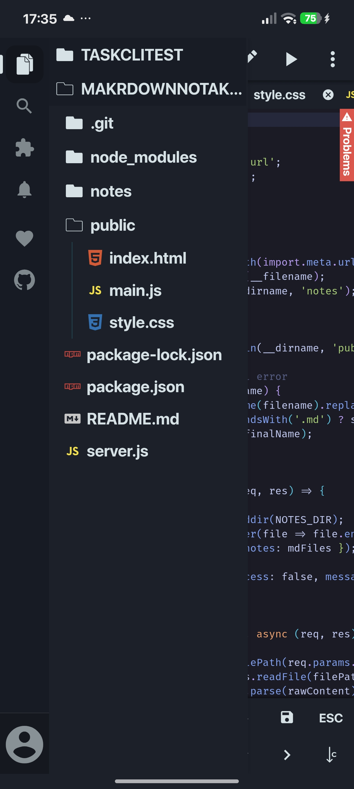
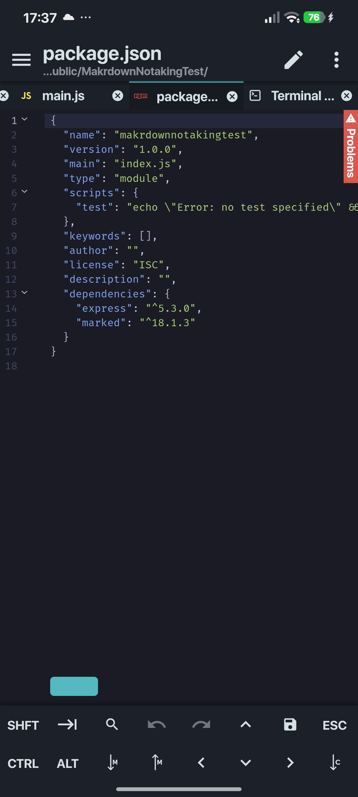
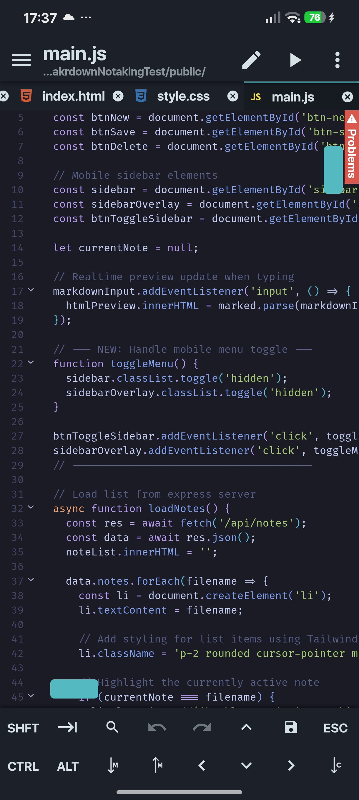
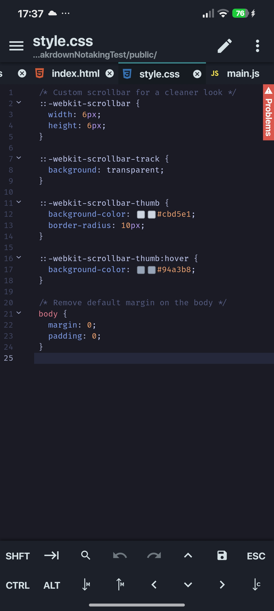
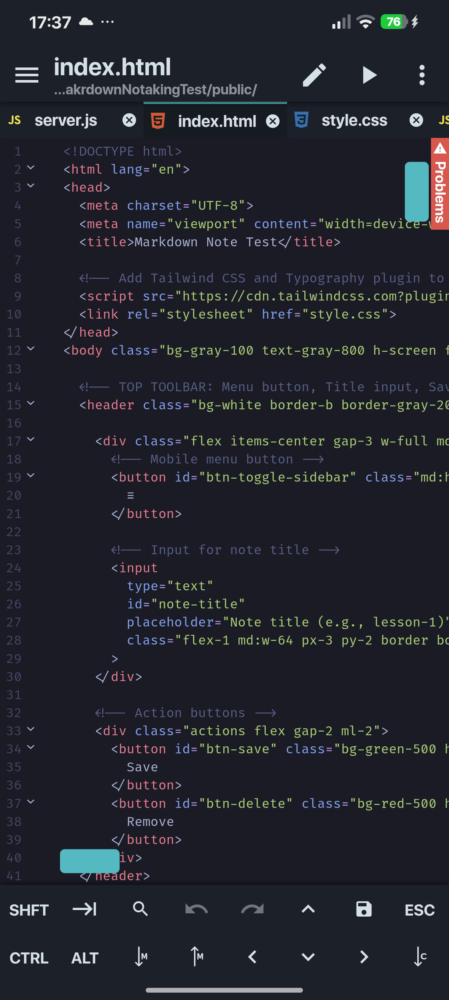
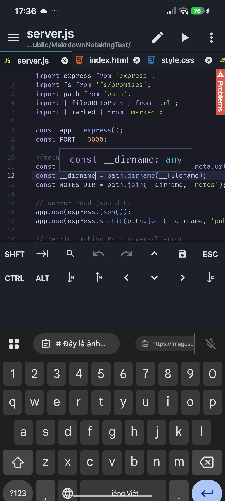
### Web UI
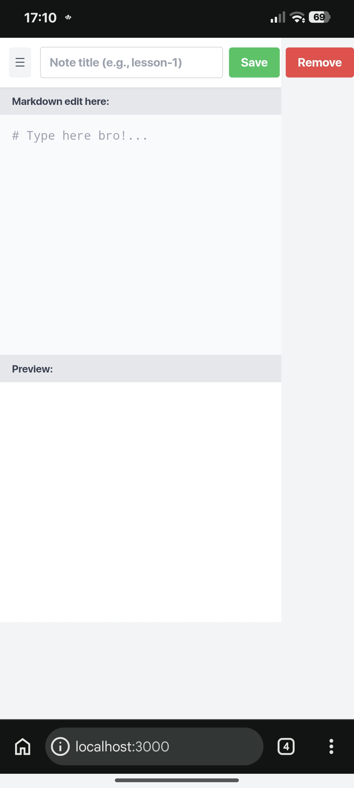
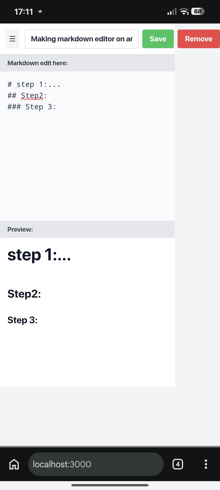
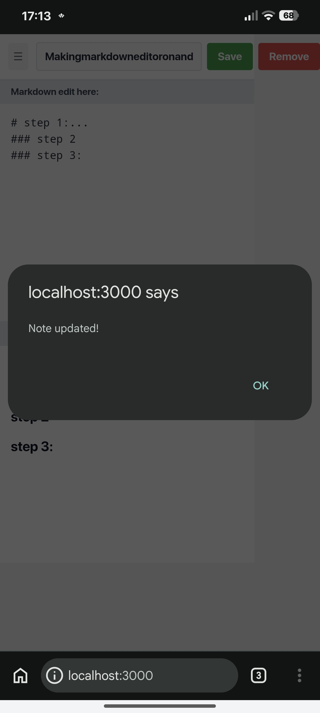
### Push code
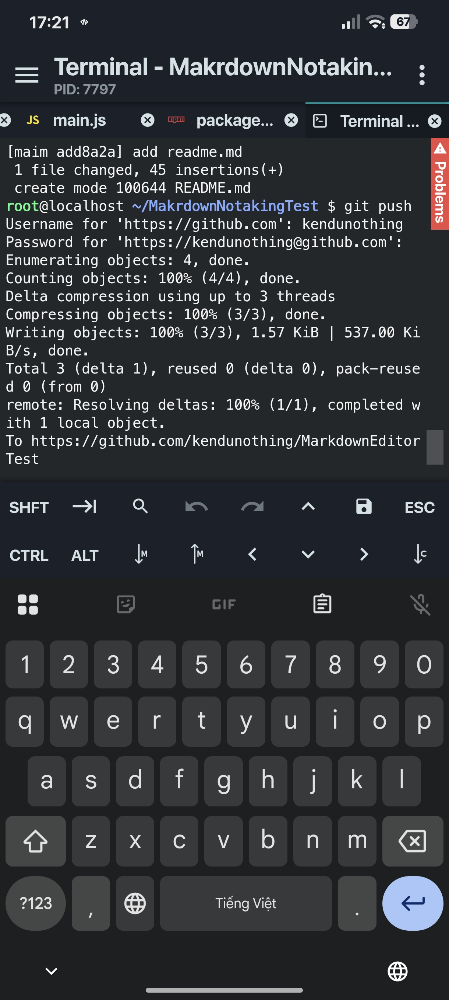
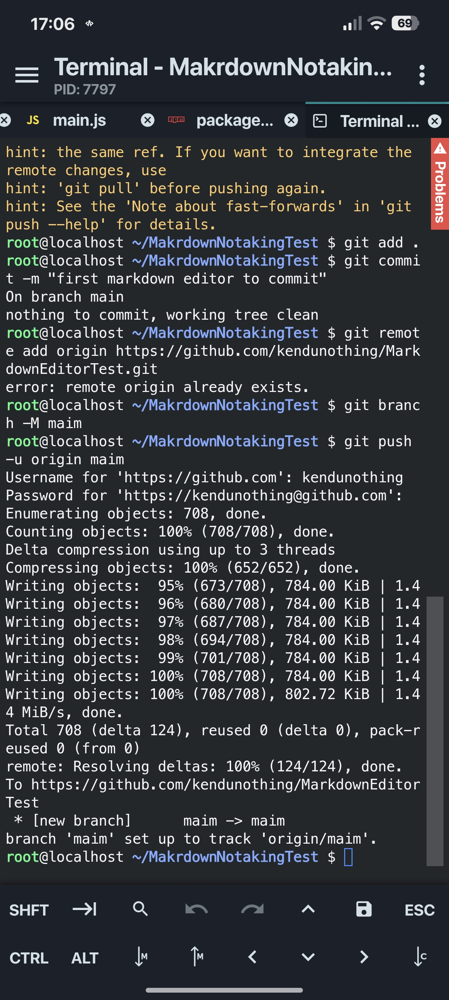
### Github
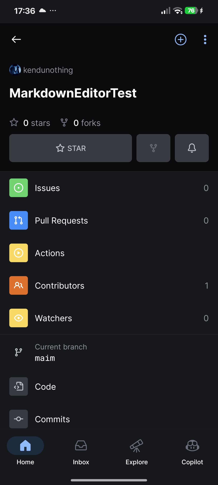
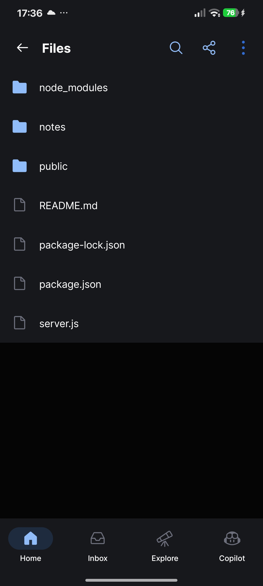
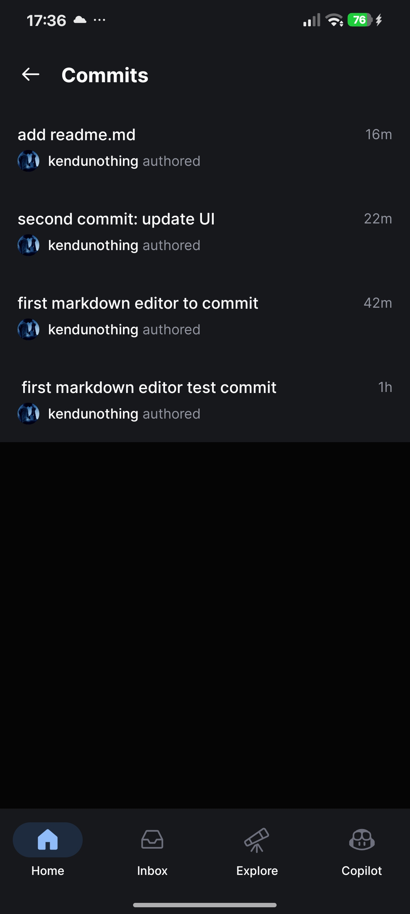

## External links:
https://roadmap.sh/projects/markdown-note-taking-app